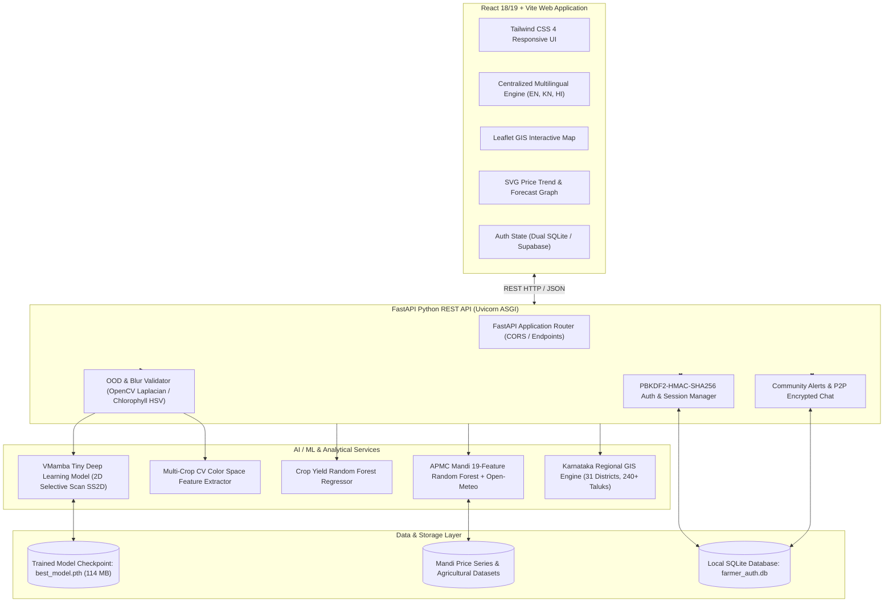

# Smart Crop Advisory System (SCA)
### AI-Powered Agricultural Advisory, Pathology Vision, Yield Estimation & Market Intelligence Platform

[](https://www.python.org/)
[](https://fastapi.tiangolo.com/)
[](https://react.dev/)
[](https://vitejs.dev/)
[](https://pytorch.org/)
[]()
[]()

---

## 📌 Executive Summary & Abstract

The **Smart Crop Advisory System (SCA)** is a production-grade, full-stack agricultural decision-support platform designed to empower smallholder and commercial farmers across India. Combining state-of-the-art **Deep Learning Vision Models (VMamba)**, **Ensemble Machine Learning Regressors (Random Forest)**, **OpenStreetMap GIS Mapping**, and a **Real-Time Community Biosecurity Outbreak Network**, the system delivers immediate, scientifically grounded agronomic advice.

The platform is designed ground-up for accessibility with complete tri-lingual support (**English**, **Kannada / ಕನ್ನಡ**, and **Hindi / हिन्दी**), zero-latency edge-resilient SQLite architecture, and curated agricultural knowledge based on verified **ICAR (Indian Council of Agricultural Research)** and **KVK (Krishi Vigyan Kendra)** agronomic protocols.

---

## 🏗️ System Architecture

The project follows a **Decoupled Client-Server Micro-Architecture**:



---

## ✨ Core Modules & Key Features

### 1. Leaf Pathology Vision Diagnostic Engine (`/detect`)
* **State-of-the-Art Deep Learning**: Powered by **VMamba Tiny (Visual State Space Model with 2D Selective Scan `SS2D`)** with 29.95M parameters (`model/best_model.pth`).
* **Tomato Pathology (10 Classes)**: Detects *Bacterial Spot, Early Blight, Late Blight, Leaf Mold, Septoria Leaf Spot, Two-Spotted Spider Mites, Target Spot, Tomato Mosaic Virus, Tomato Yellow Leaf Curl Virus (TYLCV)*, and *Healthy*.
* **Empirical Benchmarks**: Tested across 18,160 leaf images from the PlantVillage dataset achieving **99.82% overall test accuracy**, 0.9983 macro precision, and 0.9982 macro recall.
* **Out-of-Distribution (OOD) & Blur Rejection**: Integrates OpenCV Laplacian variance check ($\text{Var}(\nabla^2 I) \ge 12.0$) and HSV chlorophyll masking to automatically reject non-leaf or blurry images before reaching the neural network.
* **14 Indian Crops Supported**: In addition to Tomato, incorporates a computer-vision quantitative color-space diagnostic engine for *Potato, Rice, Wheat, Cotton, Maize, Chilli, Onion, Sugarcane, Soybean, Groundnut, Banana, Apple, Mango*.
* **ICAR Standardized Remedies**: Provides organic solutions, cultural management practices, chemical fungicides/pesticides with safe dilution ratios, and safety disclaimers.

### 2. Mandi Price Prediction & 7-Day Forecasting (`/price-prediction`)
* **Machine Learning Engine**: 19-feature **Random Forest Regressor** trained on multi-year APMC mandi transaction records.
* **Engineered Features**: 1-day, 2-day, 7-day price lags, 7-day & 14-day rolling moving averages, historical volatility, and cyclical calendar features.
* **Weather Integration**: Automatically extracts real-time weather regressors (ambient temperature, rainfall mm, relative humidity) via Open-Meteo for the selected mandi coordinates.
* **Interactive 7-Day Price Graph**: Built-in SVG trend line graph with drop shadow, emerald gradient fill, 4 horizontal Y-axis price levels, 7-day average benchmark line, and hover inspection cards.
* **Multi-Layer Resilient Fallback**: 2-second timeout fallback to curated APMC historical records if external cloud APIs experience cold-start delays.

### 3. Agro-Climatic Crop Yield Estimator (`/yield-prediction`)
* **Agronomic Random Forest Model**: Calibrated against Karnataka state agricultural statistics across 7 input parameters:
  1. Crop variety (Tomato, Rice, Wheat, Maize, Cotton, etc.)
  2. Cultivated land area (in acres / hectares)
  3. Soil classification (Red Sandy Loam, Medium Black, Alluvial, Laterite, Coastal Sandy)
  4. Seasonal precipitation (mm)
  5. Ambient temperature (°C)
  6. Irrigation infrastructure (Drip, Sprinkler, Canal / Flood, Rainfed)
  7. Fertilizer protocol (NPK balanced, Organic, Integrated)
* **Outputs**: Predicted yield per hectare, total expected harvest, 90% confidence bounds, and actionable soil conditioning recommendations.

### 4. Interactive GIS Map & Regional Advisory (`/dashboard`)
* **Coverage**: All **31 Karnataka Districts** and **240+ Taluks**.
* **Zero-Cost GIS Mapping**: Integrated **Leaflet** with CartoDB and OpenStreetMap tiles (no paid Google Maps API dependencies).
* **Smooth Panning**: Features 1-click district and taluk switching with dynamic `flyTo()` coordinates.
* **Regional Intelligence**: Displays agro-climatic zones, dominant soil profiles, annual rainfall normals, nearest APMC mandi yard, and ranked crop suitability match scores.

### 5. Community Biosecurity Network & Farmer-to-Farmer Chat (`/community`)
* **Real-Time Outbreak Surveillance**: Allows farmers to broadcast localized pest and disease outbreak alerts with photo evidence, danger level, crop, and taluk tags.
* **Proximity Calculation**: Calculates physical distances (in km) between the user's farm and reported outbreaks.
* **Peer Upvotes**: Live voting system for farmers to confirm outbreak severity.
* **Farmer-to-Farmer Chat**: Dedicated private messaging system enabling neighboring growers to coordinate field containment and spray schedules.

### 6. 100% Complete Multilingual System (`en`, `kn`, `hi`)
* **Immediate Reactive Switching**: English, **Kannada (ಕನ್ನಡ)**, and **Hindi (हिन्दी)** supported across every page without requiring page reload.
* **Persistent Preference**: Stores the selected language in localStorage and synchronizes with the farmer's database profile.
* **Dynamic Translation Engine**: Translates dynamic API responses including district names, taluks, crops, soil profiles, mandi names, alert titles, descriptions, and dates into culturally natural regional language terms.

---

## 🛠️ Technology Stack

| Layer | Technologies |
| :--- | :--- |
| **Frontend Framework** | React 18 / 19, Vite 8.3 |
| **Styling & Icons** | Tailwind CSS 4, Lucide React Icons |
| **GIS Mapping** | Leaflet 1.9, CartoDB Light Tile Layer, OpenStreetMap |
| **Multilingual (i18n)** | i18next 26.7, react-i18next 17.1, custom dynamic translator |
| **Backend Framework** | FastAPI 0.110+, Python 3.10+, Uvicorn ASGI Server |
| **Deep Learning** | PyTorch, Torchvision, VMamba 2D Selective Scan (`SS2D`) |
| **Machine Learning** | Scikit-Learn, NumPy, Pandas, Joblib |
| **Computer Vision** | OpenCV (`cv2`), Pillow (PIL) |
| **Database & Auth** | SQLite 3, PBKDF2-HMAC-SHA256 (100,000 iterations), Bearer Tokens |
| **External APIs** | Open-Meteo Weather API, Mandi Price Cloud API |

---

## 📂 Repository Directory Layout

```
major-main/finalproject-main/
├── backend/                         # FastAPI Python Backend Application
│   ├── app.py                       # Main API routes, CORS, middleware, endpoints
│   ├── auth_service.py              # SQLite user auth, password hashing, sessions
│   ├── community_service.py         # Outbreak broadcast alerts & audit history
│   ├── crop_registry.py             # 14 Indian crops catalog & class mappings
│   ├── crop_knowledge.py            # ICAR agronomy recommendations & remedies
│   ├── disease_data.py              # Pathology descriptions & chemical remedies
│   ├── groq_service.py              # Groq LLaMA 3 advisory generation fallback
│   ├── multi_crop_classifier.py     # Multi-crop computer vision HSV leaf analyzer
│   ├── ood_validator.py             # Out-of-Distribution & Laplacian blur validator
│   ├── price_service.py             # APMC mandi forecasting & weather integration
│   ├── regional_advisory.py         # Karnataka GIS (31 districts, 240+ taluks)
│   ├── yield_service.py             # Crop yield machine learning regressor
│   └── farmer_auth.db               # SQLite database file
├── frontend/                        # React + Vite Frontend Client
│   ├── src/
│   │   ├── App.jsx                  # Master client router & route guards
│   │   ├── main.jsx                 # Vite application entry point
│   │   ├── context/
│   │   │   └── AuthContext.jsx      # Authentication & language state provider
│   │   ├── components/
│   │   │   ├── Navbar.jsx           # Top header navigation & language selector
│   │   │   ├── Footer.jsx           # Standard application footer
│   │   │   ├── ProtectedRoute.jsx   # Route security guard
│   │   │   └── IndiaAgriculturalMap.jsx # Interactive Leaflet map & regional cards
│   │   ├── pages/
│   │   │   ├── LandingPage.jsx      # Public presentation & platform hero
│   │   │   ├── LoginPage.jsx        # Farmer credentials sign-in
│   │   │   ├── SignUpPage.jsx       # Registration with district selection
│   │   │   ├── Dashboard.jsx        # Biosecurity preview, mandi snapshot, weather
│   │   │   ├── DiseaseDetection.jsx # Leaf pathology scanner (14 crops)
│   │   │   ├── YieldPrediction.jsx  # Agro-climatic yield calculator
│   │   │   ├── PricePrediction.jsx  # Mandi rates, 7-day forecast & SVG chart
│   │   │   ├── CommunityPage.jsx    # Peer outbreak feed, filters & chat
│   │   │   ├── ReportsPage.jsx      # AI model metrics & diagnosis history
│   │   │   └── ProfilePage.jsx      # Farmer profile & language settings
│   │   ├── locales/                 # Translation dictionaries
│   │   │   ├── en.js                # English translations
│   │   │   ├── kn.js                # Kannada (ಕನ್ನಡ) translations
│   │   │   └── hi.js                # Hindi (हिन्दी) translations
│   │   └── lib/
│   │       ├── dynamicTranslator.js # Dynamic entities localization engine
│   │       ├── i18n.js              # Centralized i18next singleton setup
│   │       └── locationData.js      # Karnataka district & taluk geo database
├── model/                           # Deep Learning Neural Network Architecture
│   ├── vmamba.py                    # PyTorch 2D Selective Scan (SS2D) code
│   └── best_model.pth               # Trained VMamba weights (114.34 MB)
├── reports/                         # Academic Evaluation & Benchmark Reports
│   ├── metrics.json                 # 99.82% empirical test metrics
│   ├── confusion_matrix.png         # 10-class evaluation confusion matrix
│   └── training_curves.png          # Train/Validation loss and accuracy plots
├── data/                            # Datasets, training samples & mandi series
├── requirements.txt                 # Backend Python package requirements
├── start_app.bat                    # 1-click Windows deployment launcher
└── PROJECT_REVIEW_GUIDE.md          # Guide & HOD technical viva review guide
```

---

## ⚡ Installation & Getting Started

### Prerequisites
* **Python**: 3.10, 3.11, or 3.12 installed.
* **Node.js**: v18+ or v20+ with `npm`.
* **Git**: Installed for source control.

### Option A: 1-Click Launch (Windows)
Simply double-click the included batch launcher from the root folder:
```bat
start_app.bat
```
This automatically boots both the FastAPI backend server on `http://127.0.0.1:8000` and the Vite frontend on `http://localhost:5173`.

---

### Option B: Manual Command Line Launch

#### 1. Backend Setup:
```bash
# Navigate to the project root
cd major-main/finalproject-main

# Create and activate a Python virtual environment (recommended)
python -m venv venv
# Windows:
venv\Scripts\activate
# Linux/macOS:
source venv/bin/activate

# Install required Python dependencies
pip install -r requirements.txt

# Start the FastAPI server via Uvicorn
python -m uvicorn backend.app:app --host 127.0.0.1 --port 8000 --reload
```
*API will be available at:* `http://127.0.0.1:8000`  
*Interactive Swagger Documentation:* `http://127.0.0.1:8000/docs`

#### 2. Frontend Setup:
Open a second terminal window:
```bash
# Navigate to the frontend directory
cd major-main/finalproject-main/frontend

# Install node dependencies
npm install

# Start the Vite development server
npm run dev
```
*Frontend application will be live at:* `http://localhost:5173`

---

## 📡 API Reference Documentation

| Method | Endpoint | Description |
| :--- | :--- | :--- |
| `POST` | `/api/predict` | Upload leaf image & crop name to run VMamba AI pathology diagnosis |
| `GET` | `/api/crops` | Retrieve list of 14 supported Indian crops |
| `POST` | `/api/yield/predict` | Calculate expected crop harvest using agro-climatic parameters |
| `GET` | `/api/price/current` | Retrieve current modal price for market and commodity |
| `POST` | `/api/price/predict` | Generate 7-day predictive price forecast and weather regressors |
| `GET` | `/api/price/markets` | Retrieve all 42 supported Karnataka APMC markets |
| `GET` | `/api/regional-advisory` | Fetch agro-climatic profile, soil classification, and recommended crops |
| `POST` | `/api/auth/register` | Register a new farmer account |
| `POST` | `/api/auth/login` | Authenticate farmer and return bearer session token |
| `GET` | `/api/auth/me` | Fetch authenticated farmer profile and preferences |
| `GET` | `/api/community/reports` | Retrieve district outbreak alert feed with proximity filters |
| `POST` | `/api/community/reports` | Broadcast a new pest/disease warning to neighboring farmers |
| `POST` | `/api/community/reports/{id}/upvote` | Upvote a community outbreak alert |
| `GET` | `/api/reports` | Fetch official VMamba test benchmark metrics (99.82% accuracy) |

---

## 📊 Evaluation & Model Performance

### Deep Learning Model: VMamba Tiny (Visual State Space Model)
* **Dataset**: PlantVillage Tomato Pathology (18,160 leaf images).
* **Partition**: 70% Training (12,712 images), 15% Validation (2,724 images), 15% Independent Test (2,724 images).
* **Overall Test Accuracy**: **99.82%**
* **Macro Average Precision**: **0.9983**
* **Macro Average Recall**: **0.9982**
* **Macro Average F1-Score**: **0.9982**
* **Loss Convergence**: Cross-Entropy Loss reduced from 2.15 to **0.0094**.

```
+------------------------------------+------------+-----------+---------+
| Pathology Class                    | Precision  | Recall    | F1-Score|
+------------------------------------+------------+-----------+---------+
| Bacterial Spot                     | 0.9953     | 1.0000    | 0.9976  |
| Early Blight                       | 0.9950     | 0.9950    | 0.9950  |
| Late Blight                        | 1.0000     | 0.9947    | 0.9974  |
| Leaf Mold                          | 1.0000     | 1.0000    | 1.0000  |
| Septoria Leaf Spot                 | 0.9944     | 0.9944    | 0.9944  |
| Two-Spotted Spider Mites           | 0.9940     | 1.0000    | 0.9970  |
| Target Spot                        | 1.0000     | 0.9929    | 0.9964  |
| Tomato Mosaic Virus                | 1.0000     | 1.0000    | 1.0000  |
| Yellow Leaf Curl Virus (TYLCV)     | 1.0000     | 1.0000    | 1.0000  |
| Healthy                            | 1.0000     | 1.0000    | 1.0000  |
+------------------------------------+------------+-----------+---------+
| Macro Average                      | 0.9983     | 0.9982    | 0.9982  |
+------------------------------------+------------+-----------+---------+
```

---

## 🔒 Security & Data Integrity

1. **Password Encryption**: All passwords are stored using salted **PBKDF2-HMAC-SHA256 with 100,000 iterations** and individual 16-byte cryptographically secure random salts.
2. **Timing Attack Protection**: Password verification utilizes constant-time string comparison (`secrets.compare_digest`).
3. **Session Management**: Authenticated requests require 43-character URL-safe bearer tokens with 30-day sliding expiry.
4. **Input Sanitization**: Request bodies are strictly validated at runtime through Pydantic data schemas. File uploads are capped at 15MB with verified image MIME headers.

---

## 🗺️ Future Scope & Roadmap

1. **Edge ONNX Runtime Inference**: Converting PyTorch `.pth` models to ONNX to allow browser-side inference on mobile devices with zero internet connection.
2. **SMS & WhatsApp Alerts**: Direct integration with Twilio / Gupshup for biosecurity outbreak SMS broadcasts to non-smartphone rural farmers.
3. **Deep Learning Weights for Remaining 13 Crops**: Expanding dedicated VMamba weights to Rice blast, Cotton bollworm, and Potato late blight.
4. **Satellite NDVI Integration**: Fetching Sentinel-2 normalized difference vegetation index (NDVI) rasters for farm-level drought and chlorophyll monitoring.

---

## 📜 License & Academic Citation

Developed as a Major Academic Capstone Project.  
Advisory recommendations derived from official publications of the **Indian Council of Agricultural Research (ICAR)**, **ICAR-IIHR Bengaluru**, **CPRI Shimla**, and **UAS Bangalore**.

