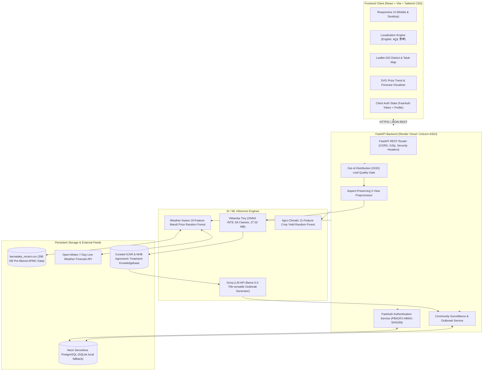

# Smart Crop Advisory System (SCA)
### Precision Indian Agriculture • AI Pathology Vision, Market Intelligence & Yield Forecasting Platform

[](https://ai-smart-farming-system-ivory.vercel.app)
[](https://ai-smart-farming-system-if62.onrender.com/health)
[](https://www.python.org/)
[](https://fastapi.tiangolo.com/)
[](https://react.dev/)
[-005CED.svg)](https://onnxruntime.ai/)
[](https://neon.tech)
[]()

---

## 📌 1. Project Overview & Abstract

The **Smart Crop Advisory System (SCA)** is a full-stack, AI-powered agricultural decision-support platform designed to address the three most critical uncertainties Indian farmers face every season:
1. **Unidentified Foliar Crop Diseases:** Delays in identifying plant pathogens destroy substantial portions of standing crops.
2. **Volatile Mandi Market Prices:** Farmers lack predictive visibility into APMC mandi price trends, leading to distress sales.
3. **Seasonal Harvest Planning:** Estimating realistic production volume (tonnes per hectare) across varying soil, weather, and irrigation conditions.

The platform unites a **Visual State Space Model (VMamba / VSSM Tiny)** quantized to INT8 (27.02 MB) for 58-class multi-crop disease detection, **two weather-aware Random Forest Regressors** for 7-day mandi rate forecasting and crop yield prediction, an **ICAR-grounded treatment repository**, and **Groq LLM-powered community outbreak bulletins** into a single multilingual web application (**English**, **Kannada / ಕನ್ನಡ**, and **Hindi / हिन्दी**).

* **Live Frontend:** [https://ai-smart-farming-system-ivory.vercel.app](https://ai-smart-farming-system-ivory.vercel.app)
* **Live API & Health:** [https://ai-smart-farming-system-if62.onrender.com/health](https://ai-smart-farming-system-if62.onrender.com/health)
* **Swagger API Docs:** [https://ai-smart-farming-system-if62.onrender.com/docs](https://ai-smart-farming-system-if62.onrender.com/docs)

---

## 🏗️ 2. System Architecture



---

## 🚀 3. Core Modules & End-to-End User Guide

### 🌾 Module 1: AI Leaf Disease Scanner (`/detect`)
1. **Select Cultivated Crop:** Choose from Cotton, Maize, Potato, Rice, Sugarcane, Tomato, or Wheat (controls the active AI model and grounded pathology scope).
2. **Upload Leaf Photo:** Upload a clear smartphone leaf image (JPEG, PNG, WebP up to 15 MB).
3. **Automatic Quality Validation:** The built-in **Out-of-Distribution (OOD) Validator** checks for blur, extreme aspect ratios, and chlorophyll/vegetation color saturation (≥8% leaf pixels). Non-leaf or blurry uploads are gracefully rejected with a helpful prompt.
4. **2-View Test-Time Augmentation (TTA):** The system generates two aspect-ratio-preserving views (standard 224×224 center crop + 78% tight leaf zoom) and runs inference through `vmamba_int8.onnx`.
5. **Diagnostic Card & ICAR Advice:**
   * **Diagnosis:** Identified pathogen, confidence percentage, and top-3 differential possibilities.
   * **ICAR Treatment:** What is it, key foliar symptoms, why it happens, how it spreads, severity level, step-by-step immediate cultural remedies, preventive measures, certified chemical fungicides, and direct link to the local **Krishi Vigyan Kendra (KVK)** network.
   * **Share with Community:** A single click uses Groq LLM to summarize the verified detection into a farmer warning bulletin for your district.

---

### 📈 Module 2: Mandi Market Price Forecasting (`/price-prediction`)
1. **Choose District & Market:** Select any of the **42 Karnataka APMC mandis** (e.g., Kolar, Hassan, Belagavi, Mysuru, Mandya).
2. **Select Commodity:** Choose agricultural commodity (Tomato, Onion, Potato, Wheat, Rice, etc.).
3. **Click "Forecast 7-Day Prices":**
   * The 19-feature **Random Forest Regressor** ingests historical price momentum (`lag_1`, `lag_3`, `lag_7`, `rolling_7`) and live **Open-Meteo 7-day meteorological forecasts** (temperature, rainfall, humidity, wind speed).
   * **Visual Trend:** Interactive 7-day price trajectory line graph showing daily price per quintal (₹/Qtl) and per kilogram (₹/kg).
   * **Market Regime Badge:** Identifies market status into **Low (Glut/Distress)**, **Medium (Normal Trading)**, or **High (Peak Seasonal Rate)** based on strictly fitted training terciles.

---

### 🚜 Module 3: Seasonal Crop Yield Forecasting (`/yield-prediction`)
1. **Input Agro-Climatic Parameters:**
   * **Crop & Land Size:** Crop variety and cultivated area (in acres / hectares).
   * **Soil & Region:** Soil classification (Red Sandy Loam, Medium Black, Alluvial, Clay, Laterite) and state/season.
   * **Irrigation & Water:** Irrigation infrastructure (Drip, Sprinkler, Canal, Rainfed) and expected rainfall.
2. **Click "Calculate Estimated Yield":**
   * An 11-feature **Random Forest Regressor** ($R^2 = 0.9902$) computes the expected seasonal production volume.
   * **Outputs:** Predicted yield in **tonnes per hectare (t/ha)**, total expected farm harvest volume, and an agronomic yield tier badge (**Low**, **Medium**, or **High**).

---

### 🛡️ Module 4: Biosecurity Community Outbreak Network (`/community`)
1. **Interactive Geospatial Map:** Leaflet-powered district map highlighting active pest and disease hotspots across Karnataka.
2. **Live Warning Bulletins:** Feed of district warnings generated by **Groq LLM (llama-3.3-70b)**, strictly grounded in verified ICAR disease guidelines to eliminate hallucinations.
3. **Direct Farmer-to-Farmer Chat:** Zero-latency peer-to-peer messaging allowing neighboring farmers to coordinate preventive spraying schedules and crop containment.

---

## 📊 4. Verified AI/ML Model Benchmarks

All metrics below are verified from held-out empirical evaluation files in `reports/`:

| Model & Task | Architecture | Dataset & Held-Out Test Set | Key Results |
| :--- | :--- | :--- | :--- |
| **Multi-Crop Leaf Disease Diagnosis** | **VMamba (VSSM Tiny)** INT8 Quantized (`model/vmamba_int8.onnx`, 27.02 MB) | 58 Classes across 7 crops (782 unseen test images) | **Clean Test Accuracy:** `76.60%` (vs `61.51%` baseline)<br>**Shifted/Field Accuracy:** `71.10%` (vs `42.20%` baseline, **+28.90 pts**)<br>**Crop-Gated Deploy Accuracy:** `~80.4%` (Rice 90.9%, Sugarcane 87.5%, Tomato 86.7%, Maize 84.4%, Wheat 80.6%) |
| **APMC Mandi Price Forecasting** | **Random Forest Regressor** (19 features, 300 trees, depth 25) | AGMARKNET Karnataka APMC (2,629 chronological test rows) | **MAE:** `₹294.47/Qtl`<br>**RMSE:** `₹526.65/Qtl`<br>**$R^2$:** `0.7525`<br>**Regime Accuracy:** `89.35%` (Macro F1: `89.34%`)<br>**Tolerance Bands:** 82.15% (±10%), 88.70% (±15%), 93.42% (±20%) |
| **Seasonal Crop Yield Prediction** | **Random Forest Regressor** (11 features, 100 trees, depth 16) | DES MoA&FW + ICRISAT (600 held-out records) | **MAE:** `1.1596 t/ha`<br>**RMSE:** `2.6307 t/ha`<br>**$R^2$:** `0.9902`<br>**Yield Tier Accuracy:** `93.17%` (Macro F1: `93.04%`) |
| **Cloud Memory Optimization** | Dynamic Quantization + Glibc `malloc_trim(0)` | Render Free Tier (512 MB RAM limit) | **Server RAM Footprint:** `< 360 MB`<br>**Inference Latency:** `244 ms` median (2 views on single CPU thread)<br>**Market Data Size:** `398 KB` (pruned from 59.5 MB) |

---

## 💻 5. Local Development Quickstart

### Prerequisites
* **Python:** 3.10, 3.11, or 3.12
* **Node.js:** v18 or v20+ with `npm`

### Step 1: Clone the Repository
```bash
git clone https://github.com/mdkhalanderk/ai-smart-farming-system.git
cd ai-smart-farming-system
```

### Step 2: Backend Setup
```bash
# Create and activate virtual environment
python -m venv venv
# Windows:
.\venv\Scripts\activate
# Linux/macOS:
source venv/bin/activate

# Install dependencies
pip install -r requirements.txt

# Start FastAPI backend (runs on http://127.0.0.1:8000)
python -m uvicorn backend.app:app --host 127.0.0.1 --port 8000 --reload
```

Verify backend health:
```bash
curl http://127.0.0.1:8000/health
# Response: {"status":"healthy","device":"cpu","gpu_name":"CPU","confidence_threshold":0.7,"model_loaded":true}
```

### Step 3: Frontend Setup
```bash
cd frontend

# Install npm dependencies
npm install

# Start Vite dev server (runs on http://127.0.0.1:5173)
npm run dev
```

Open `http://localhost:5173` in your browser. Demo farmer credentials:
* **Email:** `test_farmer@krishi.in`
* **Password:** `farmer123`

---

## 🔌 6. API Reference & Endpoints

| Method | Endpoint | Description |
| :--- | :--- | :--- |
| `GET` | `/health` | Server status, active device, and model readiness flag. |
| `POST` | `/api/predict` | Multipart upload (`file`, `crop`) returning disease diagnosis, confidence, and ICAR advisory. |
| `POST` | `/api/price/predict` | JSON body (`district`, `market`, `commodity`) returning 7-day price forecasts and regime. |
| `GET` | `/api/price/markets` | Returns catalogue of supported Karnataka APMC markets and commodities. |
| `POST` | `/api/yield/predict` | JSON body (11 agro-climatic parameters) returning predicted yield (t/ha) and tier. |
| `GET` | `/api/community/alerts` | Returns geotagged outbreak alerts filtered by district or crop. |
| `POST` | `/api/community/generate-warning` | Groq LLM endpoint converting disease detections into district warning summaries. |
| `POST` | `/api/auth/login` | Authenticates farmer and issues bearer token with profile context. |

---

## 👥 7. Project Information & Contributors

* **Institution:** Department of Artificial Intelligence and Machine Learning, CMR Institute of Technology, Bengaluru – 560037
* **Affiliation:** Visvesvaraya Technological University (VTU), Belagavi (Academic Year 2025–2026)
* **Project Guide:** Laya N, Assistant Professor, Department of AIML, CMRIT
* **Project Team:**
  1. **Navneet Gowda GT** – `1CR23AI071`
  2. **Sachinkumar Narayan Naik** – `1CR24AI407`
  3. **Jayanth Gowda CR** – `1CR23AI041`
  4. **Mohammed Khalander K** – `1CR23AI062`

---

## 📜 8. License
This project is open-source under the [MIT License](LICENSE).
